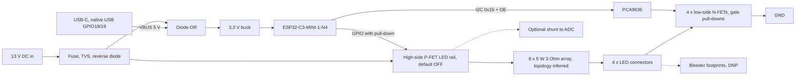

# Key Right v2: drop-in controller board

Status: planning draft, revised 2026-11-12. Not a design. Nothing has been
ordered or discussed with PCBWay. Prices are estimates unless a source is
linked; distributor prices below are single-quantity Digi-Key listings read
on 2026-11-12, not quotes.

## 1. Goals and non-goals

Goals:

- One PCB replaces the whole stock board, including its eight 5 W 3 Ω (5%)
  cement resistors. Swap: unscrew, replace, plug in the four LED panel cables,
  and land the DC input on a push-in terminal or new lead (the stock DC jack
  and rocker are soldered to pads). No signal wiring; the stock DEBUG, UART and
  FW headers are dropped.
- Fix the off-glow by owning the LED path: the LED supply is switched off in
  hardware whenever the lamp is Off and stays off through ROM boot, reset,
  brownout and USB-only power.
- Keep the v1 firmware contract (Matter light, intent/startup policy,
  recovery, OTA) with a build-time board selection.
- Safe USB: VBUS may power the ESP but never the LED rail, removing v1's
  "block VBUS or disconnect all five wires" rule.

Non-goals for `hw-v1.0`: constant-current drivers, higher output, RGB, other
Elgato models (Mini, Air, Mk.2) unless they share this board, certification
beyond a pre-certified radio module, selling boards.

## 2. Measure or confirm before layout

From the repo and [whole-board photo](../docs/references/photos/keylight-3622.png)
([power stage](../docs/references/photos/keylight-3624.png)):

| Item | Known | Unknown |
| --- | --- | --- |
| Model | Original Key Light, board type 53, HW rev 1 | Whether later production or Mk.2 share the board |
| Outline, mounting | Roughly square, 4 corner screws, bottom notch for DC jack and rocker | Dimensions, hole positions, thickness, height limits |
| Power in | 13 V / 4 A adapter; DC jack and 3-wire rocker are **soldered** to board pads; rocker bypassed ON | Rocker wiring (lamped?) |
| Logic supply | Stock buck (U1, L1) gives 3.37 V | Buck part number |
| LED outputs | Four white 2-pin connectors: F-1/J1, F-2/J3 (warm, PCA LED0), W-1/J5, W-2/J4 (cool, LED4); `+` silkscreen beside each; about 13 V unloaded when On | Connector family and pitch (looks like JST XH); polarity to confirm with a meter |
| Power stage | Eight 5 W 3 Ω resistors; four SOT-23 FETs QW1, QW2, QWM1, QWM2 with gate resistors | Topology (inferred low-side switch, two resistors per output), FET part, LED Vf and current at full PWM |
| Thermal | Resistors stand on leads in a vented plastic box | Any chassis contact; resistor temperature at full output |
| Other | `RESET` silkscreen near D6; `ON` LED D2 | Housing pinhole or light-pipe positions |

Measure, in priority order:

1. **Off-glow cause.** [The investigation](../docs/off-glow-investigation.md)
   leaves it unconfirmed; the bleeder trial dimmed it but did not remove it.
   With panels connected and the lamp Off: µA current in series with one F
   output; DC gate-to-source voltage on all four FETs; a scope trace of one
   gate if possible (steady leakage vs pulses); FET marking codes for
   datasheet leakage. v2 carries all three remedies below; this decides which
   get populated.
2. **Full-output current**: voltage across one 3 Ω resistor at maximum PWM,
   and total input current. Sizes FETs, rail switch and copper.
3. **Mechanical**: 600 dpi flatbed scan of both sides with a ruler, calipers on
   holes and outline, tallest parts, clearance above the board.
4. **Connector** pitch and housing type.
5. **Antenna**: where the v1 C3 antenna sits in the closed housing.

## 3. Block diagram

- **ESP32-C3: use the ESP32-C3-MINI-1-N4 module.** Pre-certified radio,
  4 MiB flash matching the OTA partition layout, PCB antenna (v1 is reported to work
  closed up without an external antenna). Chip-down saves about US$1 per board but
  adds RF, crystal and flash layout risk. Antenna at a board edge with keep-out.
- **Keep the PCA9635** at 0x15 with the same channel mapping. Firmware then
  changes only pins and one rail-enable output, and the 6/2 and 3/6 regression
  points should still hold if the output stage matches stock. Driving the FETs from the C3's LEDC PWM would give finer
  low-end steps than 8 bits but changes the output model (open question 1).
- **Off-glow fix, layered**, intended to remove the glow whatever its cause:
  (1) a high-side P-FET on the LED rail, gate pulled
  to 13 V (off) and switched by a small N-FET whose gate has a pull-down, so
  the rail is off whenever the C3 is not actively driving it; (2) 100 kΩ
  pull-downs on the four low-side gates; (3) bleeder footprints across each
  output, fitted only if leakage gets past two series-off devices. Firmware
  enables the rail after PCA zero is verified and drops it once a fade to Off
  settles. Use a GPIO that is not a strapping pin (avoid 2, 8, 9).
- **Resistor array:** same 5 W 3 Ω THT parts and topology as stock, so light
  output and stock PWM commands carry over. The topology is inferred until
  measurement 2 confirms it.
- **Programming/debug:** USB-C usable with lamp power on, BOOT and RESET
  buttons, test pads for 3V3, GND, UART0, EN, GPIO9. OTA after first flash.
- **Board identity in OTA images.** v1 and v2 images drive different pins, so
  each image must name its board and refuse the other's, as lamps already
  refuse `key-right-bench`.

## 4. Parts shortlist

"DK" is the Digi-Key single-unit listing price on 2026-11-12, a high bound.
LCSC search pages did not render for automated reading, so LCSC figures are
estimates; LCSC is usually 30–80% cheaper on discretes.

| Function | Candidate | DK unit | Estimate |
| --- | --- | --- | --- |
| MCU module | ESP32-C3-MINI-1-N4 | 3.26 | 2.5–3.3 |
| 3.3 V buck, 32 V in | AP63203WU-7 (alt TPS54202) | 0.64 (qty 10) | 0.4–0.7 |
| LED driver | PCA9635PW,118 (the ,112 and S911 variants are obsolete) | 3.74 | 1.5–3.8 |
| Rail switch | 30 V P-FET SO-8 (AO4407A) + 2N7002 | 1.24 + 0.16 | 0.3–1.4 |
| Low-side FETs ×4 | AO3400A, or match stock after measuring | 0.52 | 0.03–0.52 |
| Power resistors ×8 | 5 W 3 Ω 5% cement, THT | not found | 0.15–0.40 |
| LED connectors ×4 | JST B2B-XH-A (verify) | 0.10 | 0.03–0.10 |
| DC input | 2-pos push-in terminal, plus stock-position pads | – | 0.3–0.8 |
| Protection | fuse, SMBJ15A TVS, SS34 | 0.49, 1.01 | 0.3–1.8 |
| USB-C, buttons, ESD | USB-C 16-pin, 2 tact, USBLC6-2SC6 | USBLC6 0.54 | 0.4–1.3 |
| Caps, passives | electrolytics, 0402/0603 | – | 0.8–1.5 |

Per-board BOM about **US$11–19**. Turnkey orders add sourcing markup, attrition
spares and minimum quantities on passives, hence the component lines below.

## 5. Cost, first run

Assumptions: 2-layer, about 100 × 100 mm, 2 oz copper; one-sided SMT (about
25 unique lines) plus about 20 THT parts (about 50–60 joints, mostly the eight
standing 5 W resistors); turnkey sourcing by PCBWay; express courier to
Vancouver.

**Exchange.** Bank of Canada daily rate 2026-11-12: **1 USD = 1.4255 CAD**
([Valet FXUSDCAD](https://www.bankofcanada.ca/valet/observations/FXUSDCAD/json?recent=5)).
Supplier charges in USD also carry a typical **2.5% card foreign-exchange
fee**, so they cost about 1.461 CAD per USD. Import taxes and brokerage are
billed in CAD by the courier and carry no card fee.

**Assembly.** PCBWay advertises "$29 for 20pcs PCBA" and stencils from US$10
([pcb-assembly](https://www.pcbway.com/pcb-assembly.html)) but publishes no
setup, per-joint or markup figures, and quotes mixed SMT/THT orders by hand.
That headline price assumes a small SMT-only board with few part types, so
US$30 for five boards is optimistic. JLCPCB's published table (updated
2026-10-22, [pricing](https://jlcpcb.com/help/article/pcb-assembly-price))
gives a floor for this board: standard PCBA setup US$25.56, stencil US$8.21,
feeder loading US$1.53–3.07 per unique part (about US$40–75), fixtures
US$16.42, handling at least US$14.93, hand soldering US$3.58 plus
US$0.0164/joint. That is about US$110–150 for five boards before components.
Its economic tier (setup US$8.18, US$3.07 per extended part) would be about
US$55–90 if it accepts the THT parts.
Expect PCBWay at **US$80–200 for 5 boards, US$100–260 for 10**; most of it is
per-order setup, so 10 boards cost little more than 5.

**Import.** PCBWay makes the recipient the importer of record
([help](https://www.pcbway.com/helpcenter/shipping_instructions/Who_will_be_responsible_for_the_customs_duty_that_may_be_levied_at_my_country_.html)).
GST 5% and BC PST 7% both apply: 12% of goods value plus duty. For
personal imports CBSA collects PST with GST at the border, otherwise it is
self-assessed; the courier adds a brokerage fee (assumed CAD 15–40).
**Duty is not assumed to be 0%.** The 2026 CBSA tariff lists the plausible
headings as Free from China (8504.40 static converters, 8537.10 control
boards, 9405.99 lamp parts), but a lamp-related board could be classified with
LED luminaires under 9405.42/9405.49 at 7% MFN, and brokers do misclassify.
The estimate carries **0–7% duty** on goods value. The China surtax order
currently targets steel, aluminium and EVs, not circuit boards; recheck before
ordering. If sponsored boards ship with a declared value, CBSA taxes that
value even though Michael paid nothing for it, adding 12–19% of that value.

Line items, USD:

| Item | 5 boards | 10 boards |
| --- | --- | --- |
| Bare PCBs | 10–30 | 15–45 |
| Assembly (setup, stencil, SMT, THT) | 80–200 | 100–260 |
| Components incl. markup and overage | 60–130 | 110–230 |
| Express shipping | 25–45 | 30–60 |
| Import: duty 0–7%, GST 5%, PST 7%, brokerage (scenario A) | 30–100 | 40–135 |

Totals. Low ends take the low line items with 0% duty and CAD 15 brokerage;
high ends take the high line items with 7% duty and CAD 40. CAD includes the 2.5% card fee on supplier charges. Rounded to 5.

| Scenario | 5 boards USD | 5 boards CAD | 10 boards USD | 10 boards CAD |
| --- | --- | --- | --- | --- |
| A. No sponsorship | 205–505 | 295–735 | 295–730 | 425–1060 |
| B. Free PCBs | 190–470 | 280–680 | 275–675 | 400–980 |
| C. Free PCBs + free assembly | 105–230 | 150–330 | 165–365 | 240–530 |
| D. Free PCBs + 50% off assembly | 150–350 | 215–505 | 220–520 | 320–755 |

Free PCBs save only US$15–35 for 5 boards and US$20–55 for 10, including
tax; assembly is the largest variable. Hand-soldering
the eight resistors and four connectors would cut the THT part of A, B and D.

Tools: Michael has a bench supply, meter and soldering gear. Possible extras:
IR thermometer or thermocouple CAD 20–40; basic scope for gate waveforms
CAD 80–500, optional.

## 6. Risks, open questions, step plan

Risks:

- Glow cause unknown; the rail switch removes the supply path, but a different
  path may still need bleeders.
- Outline or connector mismatch breaks the drop-in claim. Fit-check a 1:1
  paper print before ordering.
- Resistor heat near the module and antenna.
- DC and rocker wires are soldered to the stock board, so "no hand wiring"
  still means moving two to five wires or making a new lead.
- PCBWay may lack exact parts; allow substitutes in the BOM.
- Duty classification and sponsored-value taxation are unconfirmed.

Open questions:

1. Keep PCA9635 (recommended, least firmware change) or drive FETs from LEDC?
2. Is moving the DC and rocker wires acceptable, or ship an adapter lead and
   drop the rocker?
3. Size for the 1–10% range in use, or full stock output (recommended)?
4. Licence: CERN-OHL-P-2.0 for `hardware/`? The public repo has no licence for
   its own code yet, so hardware and firmware licences should be chosen together.

Step plan (effort in evenings):

| Step | Effort |
| --- | --- |
| Measure (section 2), record in `docs/validation-record.md` | 1–2 |
| KiCad schematic and review | 2–4 |
| Layout, 3D and paper fit check | 3–6 |
| Quote, DFM, order | 1, then 1–3 weeks |
| Firmware board feature (pins, rail enable, OTA board identity) | 1–2 |
| Bring-up: power, USB flash, PCA readback, rail off at boot, dark-room Off | 2–3 |
| Install one lamp, soak, then the second | 1 |

## 7. Questions for PCBWay

1. Does the offer cover assembly (setup, stencil, THT) and components, or bare
   PCBs only? Is there a value cap?
2. Turnkey sourcing: which distributors, what markup; can parts be substituted
   or consigned?
3. Who pays shipping? Is DDP to Canada available, and what value and HS code
   would the invoice declare?
4. What credit do they want (README logo, silkscreen, post or video), for how
   long, and do they review posts?
5. Does the offer cover a revision run if the first board needs fixes?
6. Typical timeline for 5–10 turnkey boards with THT.
